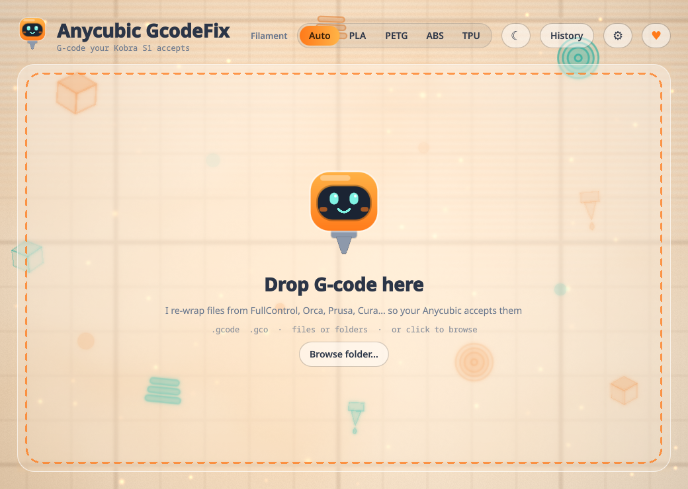
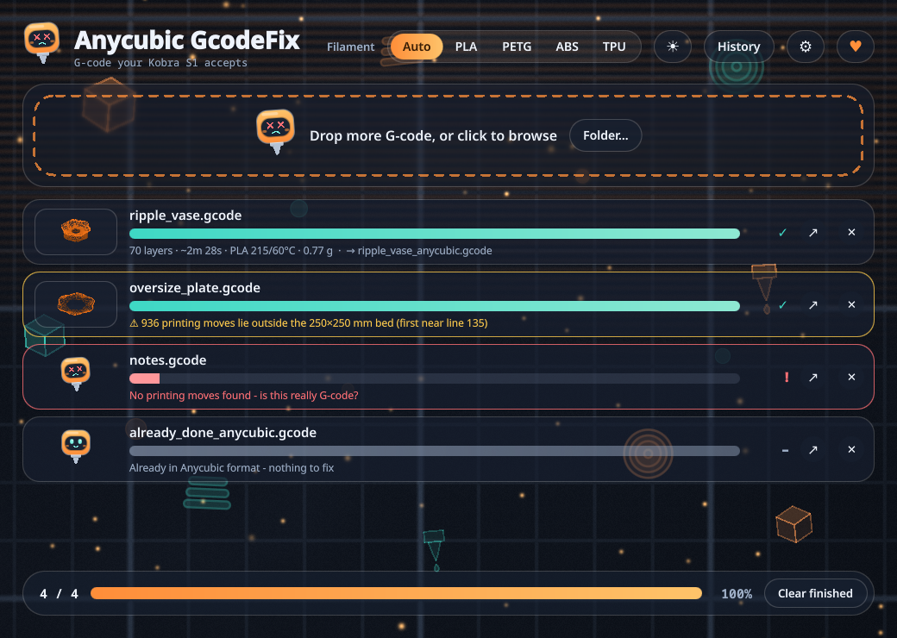
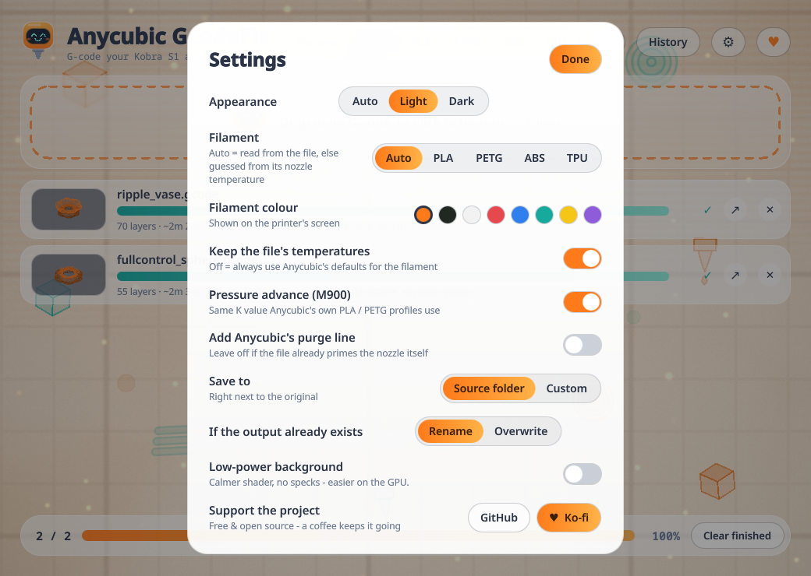
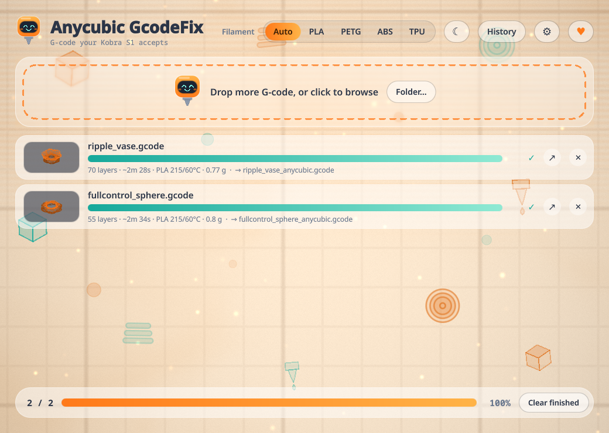

<p align="center">
  
</p>

<h1 align="center">Anycubic GcodeFix</h1>

<p align="center">
  Drag & drop G-code from <b>any slicer or generator</b> and get a copy your Anycubic printer will actually accept.<br>
  <sub>Built for the Kobra S1 · FullControl, Orca, Prusa, Cura &amp; hand-written G-code</sub>
</p>

<p align="center">
  <a href="https://github.com/Rec0iL/AnycubicGcodeFix/actions/workflows/ci.yml"></a>
  <a href="https://github.com/Rec0iL/AnycubicGcodeFix/releases/latest"></a>
  <a href="LICENSE"></a>
  <a href="https://ko-fi.com/rec0il"></a>
</p>

<p align="center">
  
</p>

## Screenshots

| Queue (dark) - done, bed warning, error, already-fixed | Settings |
|---|---|
|  |  |

<p align="center"></p>

> **Tested** on an Anycubic Kobra S1 with a G-code file generated by FullControl. Other slicers and other Anycubic models
> should work the same way but have not been printed yet - reports welcome.

## Why files get refused

The printer only takes files shaped like AnycubicSlicerNext output: a `HEADER_BLOCK`, thumbnails, an `EXECUTABLE_BLOCK`
that starts with the machine sequence (`G9111 bedTemp=… extruderTemp=…` does heating, homing and levelling) and a footer
with statistics. FullControl & co. produce bare G-code with none of that. GcodeFix keeps your toolpath and rebuilds the rest.

## What it does to a file

| Step | Detail |
|---|---|
| Wrap | header block, two thumbnails (230×110 + 512×512, rendered from your toolpath), `EXECUTABLE_BLOCK_*`, filament stats, trimmed config block |
| Start | machine limits, `G9111` with the file's own temperatures (or Anycubic defaults), `M83`, optional `M900` pressure advance |
| Remove | your file's heating / `G28` / levelling / tool-select lines **before the first printing move**, and shut-down commands after the last one (replaced by Anycubic's end sequence). Your fan, `M220`/`M221`, primer lines and all moves are kept |
| Convert | absolute extrusion (`M82`) → relative (`M83`), which the printer expects |
| Add | `;LAYER_CHANGE` markers, `M73` progress / time-remaining lines, time + filament estimates |
| Check | warns if printing moves leave the 250×250 bed or exceed 250 mm height; refuses files with no printing moves or binary `.bgcode` |

Files already in Anycubic format are skipped. The original is never touched: output is `<name>_anycubic.gcode` next to it
(or in a custom folder), renamed `(2)`… if it exists.

## Install / run

Grab the tarball from the [latest release](https://github.com/Rec0iL/AnycubicGcodeFix/releases/latest) (checksum included), or clone the repo, then:

```bash
./install.sh                 # per-user: ~/.local (menu entry + icon + `anycubic-gcodefix` command)
./install.sh --link          # per-user, symlinked to this checkout (development)
sudo ./install.sh --system   # system-wide: /usr/local
./uninstall.sh [--system] [--purge]
```

Needs PySide6 (Fedora/Nobara: `sudo dnf install python3-pyside6`, or `pip install -r requirements.txt`).

```bash
python3 main.py [files…]                    # GUI
python3 -m gcodefix.cli file.gcode [--out DIR]   # no GUI
python3 -m unittest discover -s tests -t .  # tests
```

## Settings

Filament (Auto / PLA / PETG / ABS / TPU), filament colour on the printer screen, keep-file-temperatures, pressure advance,
Anycubic purge line (off by default - FullControl and most slicers bring their own primer), output folder, overwrite
behaviour, theme (Auto / Light / Dark) and a low-power background.

*Auto* reads `; filament_type = …` if present, otherwise guesses from the nozzle temperature (≥235 ABS, ≥222 PETG, else PLA).
PLA / PETG defaults come from the Kobra S1 profiles; ABS / TPU defaults are generic and only used when the file has no temperatures.

## Notes

- The header says `generated by AnycubicSlicerNext 1.3.9.4` because that is what the printer's file check is modelled on
  (`gcodefix/profile.py`); a comment in the file says it was re-wrapped by this tool. Update the version string there if a
  firmware ever demands a newer one.
- Time / filament numbers are estimates (no acceleration model); the printer's own progress uses them only for display.
- Another Anycubic model? Edit `gcodefix/profile.py` and `gcodefix/data/kobra_s1_config.txt` (copy those from a file your
  slicer made for that printer).
- Background shader: `shaders/bg.frag`; recompile after editing:
  `qsb-qt6 --glsl "100 es,120,150" --hlsl 50 --msl 12 -o shaders/bg.frag.qsb shaders/bg.frag`

## Support

Free and open source. If it saved you a failed print or an evening of head-scratching, a coffee is very welcome:

[](https://ko-fi.com/rec0il)

There is also a ♥ button in the app. Bug reports & contributions: see [CONTRIBUTING.md](CONTRIBUTING.md).

## License

[MIT](LICENSE) © 2026 rec0il. Not affiliated with Anycubic; "Anycubic", "Kobra" and "AnycubicSlicerNext" are trademarks of their owners.
